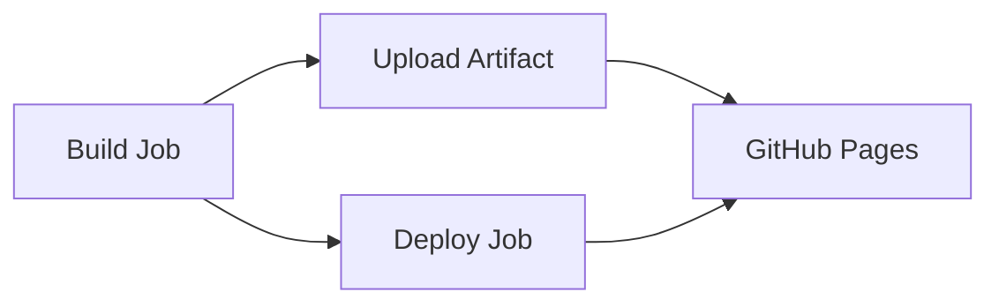

The Documentation workflow (`docs.yml`) automates the building and deployment of the BarStrad-UI documentation site to GitHub Pages using Docusaurus.

## Workflow Overview

This workflow provides automated documentation deployment with the following key features:

- **Docusaurus Integration** - Builds modern documentation sites
- **GitHub Pages Deployment** - Automatic hosting on GitHub Pages  
- **Custom Build Environment** - Uses specialized build agent container
- **Manual and API Triggers** - Flexible triggering options
- **Secure Deployment** - Minimal permissions and verified deployment

## Workflow Triggers

### Manual Execution (`workflow_dispatch`)

The workflow can be manually triggered from the GitHub Actions interface:

**Use Cases:**

- Testing documentation changes before merging
- Emergency documentation updates
- Deploying documentation after configuration changes
- Troubleshooting deployment issues

**How to Trigger:**

1. Navigate to **Actions** tab in GitHub repository
2. Select **Docs** workflow from the list
3. Click **Run workflow** button
4. Choose the branch (typically `main`)
5. Click **Run workflow** to start execution

### External API Trigger (`repository_dispatch`)

External systems can trigger documentation updates via GitHub API:

**Event Type:** `Update-Documentation`

**API Call Example:**

```bash
curl -X POST \
  -H "Accept: application/vnd.github.v3+json" \
  -H "Authorization: token YOUR_TOKEN" \
  https://api.github.com/repos/The-Running-Dev/BarStrad-UI/dispatches \
  -d '{"event_type":"Update-Documentation"}'
```

**Use Cases:**

- Integration with external documentation management systems
- Automated updates from content management workflows
- Documentation synchronization with other repositories

## Workflow Architecture

### Two-Job Pipeline

The workflow uses a sequential two-job architecture:



### Job Dependencies

- **Deploy Job** depends on successful completion of **Build Job**
- **Artifact Upload** creates the bridge between build and deployment
- **GitHub Pages Environment** provides deployment tracking

## Build Job Details

### Environment Setup

**Runner:** `ubuntu-latest`
**Container:** `ghcr.io/the-running-dev/build-agent:latest`

The custom build agent container includes:

- Node.js runtime environment
- npm/yarn package managers
- Documentation build tools
- Custom `node-template-build` command

### Build Process Steps

#### 1. Repository Checkout

```yaml
- name: Checkout Repository
  uses: actions/checkout@v4
  with:
    fetch-depth: 0
```

**Purpose:** Downloads complete repository content and git history
**Key Configuration:**

- `fetch-depth: 0` - Retrieves full git history
- Required for build processes that analyze commit history
- Ensures all documentation files are available

#### 2. Documentation Build

```yaml
- name: Build Documentation
  run: node-template-build -appDir 'documentation'
```

**Purpose:** Compiles Docusaurus project into static website
**Build Command:** `node-template-build`

- Custom command available in build agent container
- `-appDir 'documentation'` specifies source directory
- Processes markdown files, generates navigation
- Optimizes assets for production deployment

**Build Process:**

1. **Dependency Installation** - Installs Node.js packages
2. **Content Processing** - Converts markdown to HTML
3. **Asset Optimization** - Minifies CSS, JavaScript, images
4. **Navigation Generation** - Creates sidebar and navigation
5. **Static Site Generation** - Produces deployable static files

#### 3. Artifact Upload

```yaml
- name: Upload Artifact
  uses: actions/upload-pages-artifact@v3
  with:
    path: documentation/build
```

**Purpose:** Prepares built site for GitHub Pages deployment
**Artifact Contents:**

- Static HTML files
- Optimized CSS and JavaScript
- Images and other assets
- Generated navigation files

## Deploy Job Details

### Security Configuration

**Enhanced Permissions:**

```yaml
permissions:
  pages: write      # Deploy to GitHub Pages
  id-token: write   # Verify deployment authenticity
```

**Environment Setup:**

```yaml
environment:
  name: github-pages
  url: ${{ steps.deployment.outputs.page_url }}
```

### Deployment Process

#### GitHub Pages Deployment

```yaml
- name: Deploy to GitHub Pages
  id: deployment
  uses: actions/deploy-pages@v4
```

**Deployment Features:**

- **Atomic Deployment** - All-or-nothing deployment approach
- **Rollback Capability** - Previous versions remain accessible
- **Custom Domain Support** - Works with custom domain configurations
- **HTTPS Enforcement** - Automatic SSL certificate management

**Deployment Steps:**

1. **Artifact Retrieval** - Downloads build artifact from Build job
2. **Pages Configuration** - Configures GitHub Pages settings
3. **Content Deployment** - Uploads static files to Pages infrastructure
4. **DNS Update** - Updates routing to new deployment
5. **Verification** - Confirms successful deployment

## Build Agent Container

### Container Specifications

**Registry:** GitHub Container Registry (ghcr.io)
**Image:** `ghcr.io/the-running-dev/build-agent:latest`
**Base:** Node.js Alpine Linux

### Pre-installed Tools

- **Node.js** - Latest LTS version
- **npm/yarn** - Package managers
- **Python** - For native module compilation
- **Git** - Version control tools
- **Build Tools** - gcc, make, build-essential

### Custom Commands

**`node-template-build`**

- Specialized documentation build command
- Handles Docusaurus configuration
- Supports multiple documentation frameworks
- Includes optimization and minification

## Environment Variables

### Build-time Variables

| Variable | Purpose | Source |
|----------|---------|--------|
| `GITHUB_TOKEN` | Repository access | Automatic (GitHub) |
| `GITHUB_WORKSPACE` | Workspace directory | Automatic (GitHub) |
| `NODE_ENV` | Node.js environment | Build agent |

### Runtime Configuration

- **Base URL** - Configured for GitHub Pages hosting
- **Routing** - Client-side routing for SPA behavior
- **Asset Paths** - Relative paths for proper loading

## Deployment Outputs

### GitHub Pages Site

**URL Structure:**

- **Production:** `https://the-running-dev.github.io/BarStrad-UI/`
- **Custom Domain:** Configurable via repository settings

**Site Features:**

- **Responsive Design** - Mobile-friendly documentation
- **Search Functionality** - Built-in documentation search
- **Navigation** - Automated sidebar and breadcrumbs
- **Dark Mode** - Theme switching capability

### Deployment Artifacts

- **Static HTML Files** - Pre-rendered documentation pages
- **Optimized Assets** - Compressed CSS, JavaScript, images
- **Search Index** - Generated search functionality
- **Sitemap** - SEO optimization files

## Performance Optimization

### Build Optimizations

- **Tree Shaking** - Removes unused code
- **Code Splitting** - Loads pages on demand
- **Asset Optimization** - Compresses images and assets
- **Caching** - Optimizes browser caching headers

### Deployment Optimizations

- **CDN Distribution** - GitHub Pages global CDN
- **Compression** - Gzip compression for text assets
- **Caching Strategy** - Optimal cache headers
- **Preloading** - Critical resource preloading

## Monitoring and Observability

### Workflow Monitoring

**GitHub Actions Dashboard:**

- Workflow execution status
- Build duration tracking
- Error reporting and logs
- Artifact size monitoring

**Key Metrics:**

- Build success/failure rate
- Average build duration
- Deployment frequency
- Error patterns

### Site Monitoring

**GitHub Pages Status:**

- Site availability monitoring
- Performance metrics
- SSL certificate status
- Custom domain configuration

## Security Considerations

### Workflow Security

**Permission Model:**

- **Minimal Permissions** - Only required permissions granted
- **Job-level Scoping** - Different permissions per job
- **Environment Protection** - GitHub Pages environment rules

**Container Security:**

- **Isolated Execution** - Each run in fresh container
- **No Persistent State** - Stateless execution model
- **Registry Authentication** - Secure container access

### Deployment Security

**GitHub Pages Security:**

- **HTTPS Enforcement** - Automatic SSL/TLS encryption
- **Content Sanitization** - Safe static content serving
- **Access Control** - Repository-based access control

## Troubleshooting

### Common Build Issues

| Issue | Symptoms | Solution |
|-------|----------|----------|
| **Container Access Denied** | Pull errors, authentication failures | Verify `packages: write` permission |
| **Build Command Not Found** | `node-template-build: command not found` | Check build agent container version |
| **Out of Memory** | Build process killed, memory errors | Optimize build configuration |
| **Missing Dependencies** | Module not found errors | Check package.json and dependency installation |

### Common Deployment Issues

| Issue | Symptoms | Solution |
|-------|----------|----------|
| **Pages Not Updating** | Old content still visible | Check deployment logs, clear browser cache |
| **404 Errors** | Pages not found | Verify base URL configuration |
| **Asset Loading Failures** | Broken styles, missing images | Check asset paths and build output |
| **Deployment Timeout** | Deployment hangs or fails | Check artifact size and GitHub Pages limits |

### Debug Workflow

1. **Check Workflow Logs**

   ```
   GitHub → Actions → Docs Workflow → Latest Run
   ```

2. **Verify Build Artifact**
   - Download artifact from workflow run
   - Check for missing files or build errors
   - Validate HTML structure and assets

3. **Test Local Build**

   ```bash
   cd documentation
   npm install
   npm run build
   npm run serve
   ```

4. **Container Debug**

   ```bash
   docker run -it ghcr.io/the-running-dev/build-agent:latest sh
   ```

## Best Practices

### Documentation Updates

1. **Test Locally First**

   ```bash
   cd documentation
   npm start  # Development server
   npm run build  # Production build
   ```

2. **Use Meaningful Commit Messages**
   - Clear description of documentation changes
   - Reference related issues or PRs

3. **Review Generated Content**
   - Check navigation structure
   - Verify cross-references work
   - Test responsive design

### Workflow Optimization

1. **Monitor Build Performance**
   - Track build duration trends
   - Optimize large assets
   - Use caching where appropriate

2. **Version Control**
   - Tag documentation releases
   - Maintain changelog for major updates
   - Coordinate with code releases

3. **Content Strategy**
   - Keep documentation current with code changes
   - Regular content audits and updates
   - User feedback integration

## Local Testing

You can test the documentation workflow locally using Act:

```powershell
# Run documentation workflow locally
.\scripts\docs-workflow.ps1
```

For detailed local testing instructions and safe testing practices, see [Local Testing with Act](./local-testing-with-act).

## Related Documentation

- **[CI/CD Overview](./overview)** - Complete CI/CD pipeline documentation
- **[Release Workflow](./release-workflow)** - Production deployment process
- **[Local Testing with Act](./local-testing-with-act)** - Local workflow testing
- **[Development Setup](../development/setup)** - Local development environment
- **[Troubleshooting](../troubleshooting)** - General troubleshooting guide

---

**Need help with documentation deployment?** Check the [troubleshooting section](#troubleshooting) or review the [GitHub Pages documentation](https://docs.github.com/en/pages).
