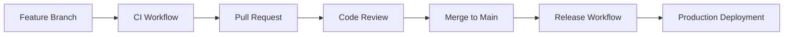

BarStrad-UI uses GitHub Actions for automated Continuous Integration and Continuous Deployment (CI/CD). This system ensures code quality, automates testing, and handles production deployments seamlessly.

## Pipeline Architecture

The CI/CD pipeline consists of three main workflows:

### 🔄 **CI Workflow** (`ci.yml`)

- **Purpose**: Validates Angular code changes and ensures quality
- **Triggers**: Pull requests, feature branch pushes, manual execution
- **Duration**: ~3-5 minutes (Angular builds take longer than bot builds)
- **Output**: Validation results (no artifacts published)
- **Key Steps**: pnpm install, ESLint, Angular production build, Docker validation

### 🚀 **Release Workflow** (`release.yml`)

- **Purpose**: Builds and deploys production Angular application with dual deployment strategy
- **Triggers**: Main branch pushes, manual execution
- **Duration**: ~5-8 minutes
- **Output**: Docker images + GitHub Pages deployment, GitHub releases, notifications
- **Key Steps**: Angular build, Docker image creation, GitHub Container Registry push, GitHub Pages deployment, documentation workflow triggering

### 📚 **Documentation Workflow** (`docs.yml`)

- **Purpose**: Builds and deploys Docusaurus documentation to GitHub Pages
- **Triggers**: Manual execution, documentation changes
- **Duration**: ~3-5 minutes
- **Output**: Static documentation site on GitHub Pages

## Workflow Separation Strategy

The pipeline uses a **separation of concerns** approach:



### Benefits of This Approach

1. **Fast Feedback**: Developers get quick validation on feature branches
2. **Resource Efficiency**: No unnecessary artifact creation during development
3. **Clear Responsibilities**: CI validates, Release deploys
4. **Risk Reduction**: Separate validation from deployment concerns

## Build Environment

Both workflows use a custom build agent container:

### Build Agent Container

- **Image**: `ghcr.io/the-running-dev/build-agent:latest`
- **Capabilities**: Node.js, Docker-in-Docker, GitVersion, custom build scripts
- **Benefits**: Consistent build environment, pre-installed tools, isolated execution

### Container Features

- **Node.js Runtime**: Latest LTS version with npm/yarn
- **Docker Support**: Docker-in-Docker for container builds
- **GitVersion**: Automatic semantic versioning
- **Build Scripts**: Custom `node-in-docker-build` command
- **Security**: Isolated execution environment

## Versioning Strategy

The project uses [GitVersion](https://gitversion.readthedocs.io/) for automatic semantic versioning:

### Version Calculation Rules

- **Major**: Breaking changes (manual bump required)
- **Minor**: New features on main branch
- **Patch**: Bug fixes and hotfixes
- **Pre-release**: Feature branch builds

### GitVersion Configuration

```yaml
mode: ContinuousDeployment
next-version: v1.0.0-alpha

branches:
  main:
    increment: Minor
  feature:
    increment: Inherit
  hotfix:
    increment: Patch
```

## Security & Permissions

### Required Secrets

All workflows require these GitHub Secrets:

| Secret                      | Purpose                          | Workflows   |
| --------------------------- | -------------------------------- | ----------- |
| `REGISTRY_TOKEN`            | GitHub Container Registry access | CI, Release |
| `NOTIFICATIONS_WEBHOOK_URL` | Build status notifications       | CI, Release |
| `DISCORD_BOT_TOKEN`         | Discord bot configuration        | CI, Release |

### Permission Model

- **CI Workflow**: `packages: write` (minimal permissions for validation)
- **Release Workflow Build Job**: `packages: write`, `contents: write` (Docker deployment & releases)
- **Release Workflow Deploy Job**: `pages: write`, `id-token: write` (GitHub Pages deployment)
- **Documentation Workflow**: `pages: write`, `id-token: write` (documentation deployment)

## Monitoring & Observability

### Build Status Monitoring

- **GitHub Actions**: Real-time workflow status
- **Status Badges**: README.md status indicators
- **Webhook Notifications**: External system integration

### Metrics Tracked

- Build success/failure rates
- Build duration trends
- Deployment frequency
- Error patterns and resolution

## Path-based Optimization

Both workflows use path exclusions to avoid unnecessary runs:

### Excluded Paths

- `documentation/**` - Documentation changes don't require builds
- `.github/**` - Workflow changes don't require validation

### Benefits

- **Resource Savings**: Fewer unnecessary builds
- **Faster Feedback**: Focus on code changes that matter
- **Cost Optimization**: Reduced CI/CD usage costs

## Integration Points

### Discord Integration

- **Bot Runtime**: Environment variables for Discord connection
- **Notifications**: Webhook integration for build/deployment status
- **Error Reporting**: Automated error notifications

### Container Registry

- **Storage**: GitHub Container Registry (ghcr.io)
- **Tagging**: Semantic version tags + latest
- **Access**: Private registry with token authentication

### GitHub Integration

- **Releases**: Automated release creation with notes
- **Pull Requests**: Status checks and validation
- **Issues**: Automatic linking and references

## Deployment Flow

### Development Flow

```text
1. Developer creates feature branch
2. CI workflow validates changes on push
3. Developer opens pull request
4. CI workflow validates PR changes
5. Code review process
6. Merge to main branch
7. Release workflow builds and deploys
8. Notifications sent to team
```

### Emergency Release Flow

```text
1. Manual trigger of Release workflow
2. Build from current main branch
3. Deploy to production
4. Notifications sent
5. Post-deployment verification
```

## Dual Deployment Strategy

The Release workflow implements a **dual deployment strategy** to maximize availability and deployment options:

### Docker Container Deployment

- **Target**: GitHub Container Registry (`ghcr.io/the-running-dev/barstrad-ui`)
- **Format**: Production-ready Docker image with nginx
- **Benefits**: Scalable, portable, environment-agnostic
- **Use Cases**: Docker hosting, Kubernetes deployments, private cloud
- **Access**: Private registry requiring authentication

### GitHub Pages Deployment

- **Target**: GitHub Pages hosted static site
- **Format**: Optimized Angular application bundle
- **Benefits**: Free hosting, CDN distribution, HTTPS by default
- **Use Cases**: Public access, documentation, demo environments
- **Access**: Public URL with optional custom domain

### Deployment Coordination

```text
Angular Build → Docker Image Creation → Registry Push
      ↓
Build Artifacts → GitHub Pages Upload → Static Site Deployment
      ↓
Documentation Detection → Docs Workflow Trigger (if needed)
```

### Benefits of Dual Strategy

1. **Deployment Flexibility**: Multiple hosting options available
2. **High Availability**: Redundant deployment targets
3. **Cost Optimization**: Free GitHub Pages + scalable Docker options
4. **Developer Experience**: Easy access via GitHub Pages for testing
5. **Production Ready**: Docker containers for enterprise deployment

## Best Practices Implemented

### Development Best Practices

1. **Automated Validation**: Every change is automatically tested
2. **Branch Protection**: Main branch requires PR validation
3. **Code Quality**: Consistent build environment ensures quality
4. **Fast Feedback**: Quick validation for rapid development

### Deployment Best Practices

1. **Automated Deployment**: No manual deployment steps
2. **Rollback Capability**: Docker tags enable easy rollbacks
3. **Health Checks**: Automated deployment verification
4. **Notifications**: Team awareness of deployments

### Security Best Practices

1. **Secret Management**: Secure storage of sensitive data
2. **Minimal Permissions**: Least privilege access model
3. **Container Security**: Isolated build environments
4. **Token Rotation**: Regular credential updates

## Required GitHub Secrets

The CI/CD workflows require the following secrets to be configured in GitHub:

| Secret                      | Purpose                                     | Workflows   |
| --------------------------- | ------------------------------------------- | ----------- |
| `REGISTRY_TOKEN`            | GitHub token with package write permissions | Release     |
| `NOTIFICATIONS_WEBHOOK_URL` | Webhook URL for build notifications         | CI, Release |
| `DISCORD_BOT_TOKEN`         | Discord bot authentication token            | CI, Release |

### Secret Configuration

1. **Navigate to Repository Settings** → Secrets and variables → Actions
2. **Add each required secret** with the appropriate values
3. **Verify permissions** ensure tokens have necessary access
4. **Test workflows** to confirm secrets are working correctly

## Troubleshooting CI/CD Issues

### Common Build Failures

1. **TypeScript Errors**: Check source code compilation
2. **Docker Build Issues**: Review Dockerfile and dependencies
3. **Permission Errors**: Verify GitHub token permissions
4. **Container Access**: Check build agent availability

### Debugging Strategies

1. **Workflow Logs**: Review detailed GitHub Actions logs
2. **Local Testing**: Reproduce builds locally with Docker
3. **Manual Triggers**: Test workflows manually for debugging
4. **Environment Validation**: Verify all required secrets
5. **Local Workflow Testing**: Use Act to test workflows locally - see [Local Testing with Act](./local-testing-with-act)

## Next Steps

- **[CI Workflow Details](./ci-workflow)** - Detailed CI workflow validation process
- **[Release Workflow Details](./release-workflow)** - Comprehensive release process, versioning, and troubleshooting
- **[Documentation Workflow](./docs-workflow)** - Automated documentation deployment to GitHub Pages
- **[Production Build Script](./build-script)** - Containerized build process for local development
- **[Workflow Comparison](./workflow-comparison)** - Side-by-side comparison of CI vs Release workflows
- **[Local Testing with Act](./local-testing-with-act)** - Test GitHub Actions workflows locally
- **[Deployment Guide](./deployment-guide)** - Production deployment procedures

---

**Ready to dive deeper?** Check out the detailed [CI Workflow](./ci-workflow), [Release Workflow](./release-workflow), or [Documentation Workflow](./docs-workflow) documentation.
